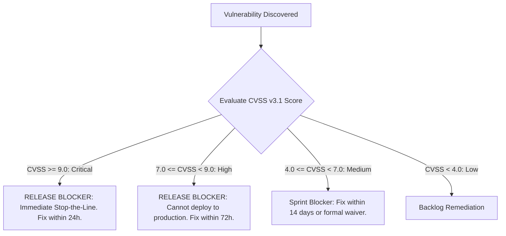

# SECURITY TESTING AND APPLICATION PENETRATION SPECIFICATION

**Document Reference:** `docs/quality/SECURITY_TESTING_STRATEGY.md`  
**Phase:** 11 — Comprehensive Testing Strategy, Quality Assurance & Validation Framework  
**Status:** Approved Technical Architecture  
**Author:** Principal Security QA Architect & Penetration Tester  
**Traceability:** NFR-SEC-01 through NFR-SEC-09, ADR-007, ADR-010  

---

## 1. Executive Summary & Security Verification Baseline

Security verification for HeartXAI 2.0 ensures that all technical defenses specified in Phase 9 (Security Architecture & Threat Model) and Phase 10 (DevOps & Infrastructure Security) are empirically validated against known exploit vectors before any production release.

The security testing program executes in CI/CD pipelines and isolated staging environments, covering:
1. **Automated Penetration Fuzzing** (OWASP Web Top 10 & API Security Top 10).
2. **Anti-IDOR & Multi-Tenant Boundary Audits**.
3. **Static Application Security Testing (SAST)** and **Software Composition Analysis (SCA)**.
4. **Container Image Vulnerability Scans**.

> [!CRITICAL]
> **Retesting Mandate:**  
> A security vulnerability is **never** reported as closed or fixed based on code review alone. A finding is marked resolved only after the automated regression test case that demonstrated the initial exploit executes and confirms remediation.

---

## 2. Automated Vulnerability & Exploitation Test Matrix

| Attack Category | Vulnerability Target | Automated Exploit Test Scenario | Injected Payload / Tool | Asserted Defense & Expected Behavior |
| :--- | :--- | :--- | :--- | :--- |
| **SQL Injection (SQLi)** | Search & filter query parameters | Fuzzing search routes with tautological payloads | `' OR 1=1 --`, `1; DROP TABLE users;` | HTTP 200 (Properly escaped) or HTTP 422; zero SQL syntax errors or schema leaks |
| **Cross-Site Scripting (XSS)** | Medical report notes & profile name fields | Injecting HTML/JS into stored database fields | `<script>alert(document.cookie)</script>` | React JSX and DOMPurify contextually escape strings; zero unescaped execution |
| **Insecure Direct Object Reference (IDOR)**| `/api/v1/predictions/{id}` | Querying records belonging to another patient | Authenticated User 101 requesting record 502 | Returns **HTTP 404 Not Found**; zero clinical data or probability scores leaked |
| **Server-Side Request Forgery (SSRF)** | Country directory adapter lookups | Manipulating host parameter to target internal IPs | `http://169.254.169.254/latest/meta-data/` | Outbound HTTP client blocks private RFC 1918 and link-local IP resolution |
| **Malicious File Upload RCE** | `/api/v1/files/upload` | Uploading PHP/shell script disguised as PDF | `payload.pdf.php` with valid PDF magic bytes | Magic-byte MIME verification + ClamAV sandbox reject payload with HTTP 415 |
| **Secret & Key Leakage** | Source code & commit logs | Scanning Git history and staged files | `gitleaks detect --redact` | CI runner aborts immediately if regex patterns match API keys or private keys |
| **Dependency Vulnerabilities** | Python wheels & npm packages | Scanning lockfiles against CVE databases | `pip-audit` & `npm audit --audit-level=high` | Build fails if any High or Critical CVE is present in dependency tree |
| **Container Breakout** | Production Docker container images | Scanning base image OS packages | `trivy image heartxai-backend:sha-xxx` | Zero unresolved Critical CVEs; maximum 2 High with documented waivers |
| **Brute Force & Rate Limit Bypass** | `/api/v1/auth/login` | Firing 20 rapid login attempts from single IP | Automated HTTP burst script | Requests 6 through 20 return HTTP 429 Too Many Requests |
| **CSRF & Cookie Hijacking** | Refresh token cookie delivery | Inspecting `Set-Cookie` response headers | Header inspection script | Cookie contains `HttpOnly`, `Secure`, `SameSite=Strict`, `Path=/api/v1/auth` |

---

## 3. Severity-Based Release Blockers & Triage SLA

Vulnerabilities discovered during testing are scored via **CVSS v3.1**:



---

## 4. Retesting & Verification Workflow

```text
Discovery (Automated Scanner / Pen Test)
    │
    ▼
Creation of Automated Exploit Regression Test (test_sec_cve_xxxx.py)
    │
    ▼
Verify Test FAILS against Vulnerable Build (Reproduces Exploit)
    │
    ▼
Engineering Applies Patch / Upgrades Dependency
    │
    ▼
Re-execute Automated Test Suite (Must PASS cleanly)
    │
    ▼
Vulnerability Marked RESOLVED in Security Ledger
```
