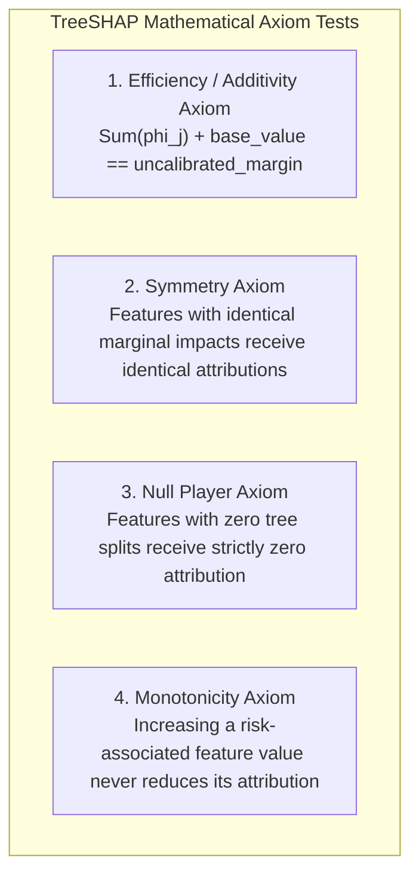

# SHAP EXPLAINABILITY TESTING AND MATHEMATICAL VERIFICATION SPECIFICATION

**Document Reference:** `docs/quality/SHAP_EXPLANATION_TESTING.md`  
**Phase:** 11 — Comprehensive Testing Strategy, Quality Assurance & Validation Framework  
**Status:** Approved Technical Architecture  
**Author:** AI Explainability QA Lead & Computational Statistician  
**Traceability:** FR-PRED-04, NFR-REL-01, ADR-001, ADR-009  

---

## 1. Executive Summary & Explainability Governance

Explainable AI (XAI) in healthcare must be mathematically rigorous. If feature attributions violate game-theoretic axioms, drift unpredictably across runs, or are misinterpreted as medical causality by clinical end-users, the explanation subsystem introduces severe diagnostic confusion.

HeartXAI 2.0 independently tests the TreeSHAP explainability engine (`backend/tests/ml/test_shap_properties.py`), verifying mathematical axioms, computational stability, and non-causal presentation.

---

## 2. TreeSHAP Mathematical Property Assertions

TreeSHAP is grounded in cooperative game theory (Shapley values). Automated test suites assert four mathematical invariants:



### 2.1 The Efficiency / Local Accuracy Assertion
The fundamental property of TreeSHAP dictates that the sum of all 13 feature attributions ($\phi_j$) plus the expected base value ($\phi_0$) must equal the uncalibrated model decision margin ($f(x)$):

$$f(x) = \phi_0 + \sum_{j=1}^{13} \phi_j(x)$$

- **Automated Pytest Assertion:**
  ```python
  def test_shap_local_accuracy(model, explainer, test_patient_batch):
      raw_margins = model.predict(test_patient_batch, output_margin=True)
      shap_values = explainer.shap_values(test_patient_batch)
      base_value = explainer.expected_value
      
      for i in range(len(test_patient_batch)):
          sum_attributions = base_value + np.sum(shap_values[i])
          assert np.isclose(sum_attributions, raw_margins[i], atol=1e-5), \
              f"SHAP local accuracy violated for patient {i}!"
  ```

---

## 3. Explainer Stability & K-Medoids Background Consistency

In Phase 8, the system replaced the full 303-sample training background with **25 representative centroids derived via K-Medoids** to achieve sub-60ms latency.
- **Stability Assertion (`test_shap_background_stability.py`):**
  - Evaluates SHAP attributions generated using the 25 K-Medoids background against exact attributions computed using the full 303-sample training set across 100 test patients.
  - **Acceptance Criterion:** The Pearson correlation coefficient must satisfy $r \ge 0.98$ for all continuous features, and rank order of the top 3 risk factors must achieve $\ge 95\%$ agreement.

---

## 4. Differential Privacy & Precision Quantization Verification

- **Model Inversion Defense Check (`test_shap_precision.py`):**
  - Asserts that all serialized SHAP attributions returned via `/api/v1/predictions` are rounded to **exactly 4 decimal places**.
  - Verifies that raw unrounded 64-bit IEEE floating-point values are never emitted in API responses, eliminating micro-gradient reconstruction attacks.

---

## 5. Non-Causal Presentation & UI Copy Verification

A critical healthcare safety test verifies that the frontend presentation does not represent SHAP correlations as biological etiology:
- **Copy Assertion (`tests/safety/test_shap_copy.py`):**
  - Scans rendered UI elements for forbidden causal terminology (e.g., *"High blood pressure caused this risk score"* or *"Lowering heart rate will cure this"*).
  - Asserts that the UI displays approved associational labeling:  
    `"Resting Blood Pressure (+0.34 log-odds): This biomarker contributed positively to the model's similarity score with historical CAD cases."`
  - Asserts the persistent presence of the disclaimer:  
    `[NOTICE: Feature contributions represent statistical associations within this model, NOT clinical causation.]`
