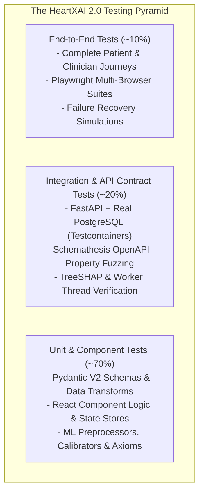

# TESTING PYRAMID AND COMPREHENSIVE TEST CATEGORIES SPECIFICATION

**Document Reference:** `docs/quality/TESTING_PYRAMID_AND_TEST_CATEGORIES.md`  
**Phase:** 11 — Comprehensive Testing Strategy, Quality Assurance & Validation Framework  
**Status:** Approved Technical Architecture  
**Author:** Principal QA Architect & Systems Test Specialist  
**Traceability:** NFR-REL-01, NFR-PERF-01, NFR-SEC-01 through NFR-SEC-09, ADR-001, ADR-007  

---

## 1. Executive Summary & The Testing Pyramid

The HeartXAI 2.0 testing architecture distributes test coverage across a balanced **Testing Pyramid**. Inverting the pyramid (relying excessively on brittle, slow end-to-end tests) leads to flakiness, inflated CI runtimes, and delayed feedback. Conversely, relying exclusively on unit tests leaves integration seams, asynchronous worker communication, and database constraints unverified.

---

## 2. Comprehensive 14-Category Testing Framework

The quality program decomposes verification into 14 distinct testing disciplines:

### Category 1: Unit Testing
- **Purpose:** Verifies that individual Python functions, Pydantic schemas, mathematical calculators, and React utility functions produce exact outputs for given inputs in isolation.
- **Scope:** Business logic, algorithmic formula implementations, unit converters, date formatters, and utility functions.
- **Tools Under Consideration:** `pytest` (backend), `vitest` (frontend).
- **Environment:** Local developer workstation / Ephemeral CI runner (zero external dependencies).
- **Entry Criteria:** Clean compilation and formatting checks.
- **Exit Criteria:** 100% test pass rate; line coverage $\ge 85\%$ on tested modules.
- **Evidence Retained:** Junit XML test execution report and HTML coverage artifact.

---

### Category 2: Component Testing
- **Purpose:** Verifies that isolated UI components (forms, modal dialogues, navigation bars, visual score cards) render correctly, handle user interactions, update internal state, and announce accessibility labels.
- **Scope:** React component library, form inputs, waterfall charting widgets, error boundary fallbacks.
- **Tools Under Consideration:** `React Testing Library`, `@testing-library/user-event`, `vitest`.
- **Environment:** Node.js virtual DOM (`jsdom` / `happy-dom`) in CI runner.
- **Entry Criteria:** TypeScript compilation succeeds with zero errors.
- **Exit Criteria:** All component state permutations (default, loading, error, empty) render as specified.
- **Evidence Retained:** Component test execution logs and snapshot/DOM assertion logs.

---

### Category 3: Integration Testing
- **Purpose:** Verifies that multiple software modules interact correctly across internal boundaries (FastAPI service to database repository, API dependency to Redis cache, backend worker to ML C++ booster).
- **Scope:** Service tier methods, authentication token validation pipelines, background worker queue handling.
- **Tools Under Consideration:** `pytest`, `pytest-asyncio`, `respx` (HTTP mocking).
- **Environment:** Containerized CI environment with dedicated temporary Redis and PostgreSQL instances.
- **Entry Criteria:** Unit tests pass cleanly.
- **Exit Criteria:** All service-to-service transactions execute atomically and handle boundary errors.
- **Evidence Retained:** Integration test logs and transaction boundary trace records.

---

### Category 4: API & Contract Testing
- **Purpose:** Verifies that all exposed REST endpoints conform strictly to the published OpenAPI 3.1 specification, validate input payloads, enforce authentication/authorization, and filter output schemas.
- **Scope:** All routes under `/api/v1/*`.
- **Tools Under Consideration:** `httpx.AsyncClient`, `schemathesis` (property-based contract fuzzing).
- **Environment:** Isolated staging/test container environment.
- **Entry Criteria:** Backend service passes health check (`/health/live`).
- **Exit Criteria:** 100% endpoint schema compliance; zero 500 Internal Server Errors under invalid payload fuzzing.
- **Evidence Retained:** OpenAPI schema validation report and contract compliance log.

---

### Category 5: Database Testing
- **Purpose:** Verifies schema integrity, foreign key cascades, check constraints, unique indexes, row-level security (RLS) policies, and forward/backward migration execution.
- **Scope:** PostgreSQL 16 relational database schema, Alembic migrations, connection pool governance.
- **Tools Under Consideration:** `pytest`, `testcontainers-python` (real PostgreSQL 16 container).
- **Environment:** Isolated PostgreSQL 16 test container (strictly rejecting SQLite for Postgres-specific tests).
- **Entry Criteria:** PostgreSQL container ready and listening on port 5432.
- **Exit Criteria:** All DDL migrations apply cleanly; constraint violations raise expected exceptions; RLS blocks cross-tenant reads.
- **Evidence Retained:** Migration execution logs and constraint validation reports.

---

### Category 6: End-to-End (E2E) Testing
- **Purpose:** Validates complete real-world user journeys across the full stack (browser UI $\rightarrow$ Nginx proxy $\rightarrow$ FastAPI $\rightarrow$ ML Engine $\rightarrow$ PostgreSQL), verifying that real user goals succeed.
- **Scope:** Patient registration, clinical assessment submission, SHAP inspection, report download, clinician review, unauthorized access attempts.
- **Tools Under Consideration:** `Playwright` (Chromium, Firefox, WebKit).
- **Environment:** Staging environment with synthetic test datasets.
- **Entry Criteria:** Frontend and backend containers deployed and `/health/ready` returns HTTP 200.
- **Exit Criteria:** 100% of critical patient journeys complete successfully without UI crashes or uncaught console exceptions.
- **Evidence Retained:** Playwright trace archives, execution videos, and full-page failure screenshots.

---

### Category 7: Machine Learning Validation
- **Purpose:** Scientifically evaluates model generalizability, probability calibration, deterministic reproducibility, data leakage prevention, and algorithmic fairness.
- **Scope:** Preprocessing pipelines, XGBoost model weights, Platt scaling calibrator, TreeSHAP explainer, counterfactual solver.
- **Tools Under Consideration:** `pytest`, `scikit-learn`, `numpy`, `scipy`.
- **Environment:** Hermetic testing container with pinned CPU floating-point instructions.
- **Entry Criteria:** Dataset SHA-256 verified and model artifacts cryptographically signed.
- **Exit Criteria:** Outer cross-validated ROC-AUC $\ge 0.85$, Brier score $\le 0.14$, ECE $\le 0.06$, Subgroup ratio $0.85 - 1.15$, identical output probabilities across 1,000 seeded passes.
- **Evidence Retained:** Model Card validation metrics, calibration curves, and fairness audit logs.

---

### Category 8: Security Testing
- **Purpose:** Validates application defenses against malicious exploitation, unauthorized access, privilege escalation, and data breaches.
- **Scope:** OWASP Top 10 Web Application & API Security, IDOR verification, injection fuzzing, secret scanning, container vulnerability analysis.
- **Tools Under Consideration:** `gitleaks`, `bandit`, `semgrep`, `pip-audit`, `npm audit`, `trivy`, `OWASP ZAP`.
- **Environment:** Staging environment and CI/CD security scanning runners.
- **Entry Criteria:** Clean source code build.
- **Exit Criteria:** Zero Critical or High vulnerabilities across code, dependencies, and container images.
- **Evidence Retained:** Security scan reports, vulnerability triage ledgers, and remediation proofs.

---

### Category 9: Performance & Reliability Testing
- **Purpose:** Verifies that system latency, throughput, and resource consumption satisfy Service Level Objectives (SLOs) under steady-state and peak stress workloads.
- **Scope:** API response times, ML inference pipeline latency, database connection pool saturation, memory leak detection.
- **Tools Under Consideration:** `locust` (distributed load testing), `pytest-benchmark`.
- **Environment:** Dedicated staging cloud instance with production-parity compute.
- **Entry Criteria:** Application deployed and pre-warmed.
- **Exit Criteria:** API $P95 < 200\text{ ms}$; ML pipeline $P95 \le 150\text{ ms}$; zero memory growth across 8-hour soak test at 50 concurrent users.
- **Evidence Retained:** Locust HTML performance reports, percentile latency graphs, and resource utilization traces.

---

### Category 10: Accessibility Testing
- **Purpose:** Ensures the application is usable by individuals with visual, motor, auditory, or cognitive disabilities in compliance with WCAG 2.2 Level AA standards.
- **Scope:** All patient-facing pages, assessment forms, visual risk score cards, SHAP waterfall charts, modal dialogues, alert banners.
- **Tools Under Consideration:** `@axe-core/playwright`, `Google Lighthouse`, manual NVDA / VoiceOver screen-reader audits.
- **Environment:** Staging frontend instance.
- **Entry Criteria:** Frontend UI fully rendered with final CSS tokens.
- **Exit Criteria:** Zero automated axe-core violations; 100% keyboard navigable; WCAG AAA color contrast on critical medical text.
- **Evidence Retained:** Automated axe-core accessibility audit JSON reports and manual screen-reader sign-off sheets.

---

### Category 11: Compatibility & Localization Testing
- **Purpose:** Verifies that the application renders consistently across diverse web browsers, operating systems, screen dimensions, timezones, and localized measurement units.
- **Scope:** Chrome, Firefox, Safari, Edge; Mobile/Tablet/Desktop viewports; Timezones (UTC, IST, CET, EST); Units ($\text{mg/dL} \leftrightarrow \text{mmol/L}$).
- **Tools Under Consideration:** `Playwright` device emulation, browser matrix runners.
- **Environment:** Staging multi-browser test runners.
- **Entry Criteria:** Staging deployment verified active.
- **Exit Criteria:** Zero layout breaks or functional regressions across top 4 browsers; unit conversion mathematically verified.
- **Evidence Retained:** Cross-browser test matrix logs and responsive screenshot comparisons.

---

### Category 12: Regression Testing
- **Purpose:** Confirms that new code commits, bug fixes, or dependency updates do not break existing functional behavior or re-introduce previously remediated defects.
- **Scope:** Full automated test suite across unit, integration, and E2E tiers.
- **Tools Under Consideration:** GitHub Actions automated test runners.
- **Environment:** Automated CI testing environment.
- **Entry Criteria:** Pull request opened or code committed to branch.
- **Exit Criteria:** 100% pass rate across entire regression baseline suite.
- **Evidence Retained:** CI workflow execution logs and historical trend dashboards.

---

### Category 13: User Acceptance Testing (UAT)
- **Purpose:** Validates that the application satisfies real clinical user workflows, business objectives, and usability expectations from the perspective of patients and healthcare providers.
- **Scope:** Core patient journeys, clinical interpretation clarity, consent transparency, report export usability.
- **Tools Under Consideration:** Structured user evaluation scripts, feedback tracking forms.
- **Environment:** Staging sandbox populated with clearly marked synthetic patient cohorts.
- **Entry Criteria:** All functional, security, and accessibility release gates passed.
- **Exit Criteria:** Formal sign-off from clinical stakeholder and product owner.
- **Evidence Retained:** Completed UAT evaluation scorecards and stakeholder sign-off records.

---

### Category 14: Healthcare Safety Validation
- **Purpose:** Specifically validates that the application functions strictly as a non-diagnostic Clinical Decision Support aid and never provides automated medical diagnoses, treatment prescriptions, or misleading clinical guidance.
- **Scope:** Clinical disclaimers, emergency contraindication triggers, non-causal SHAP phrasing, bounded counterfactual guidance, regulatory boundary notices.
- **Tools Under Consideration:** Automated text assertion suites, Clinical Advisory Committee review.
- **Environment:** Staging environment and static documentation audit.
- **Entry Criteria:** Final UI copy and clinical report templates committed.
- **Exit Criteria:** Zero diagnostic claims detected; emergency warning flows verified; medical board approval documented.
- **Evidence Retained:** Healthcare safety audit ledger and clinical advisory sign-off certificate.
