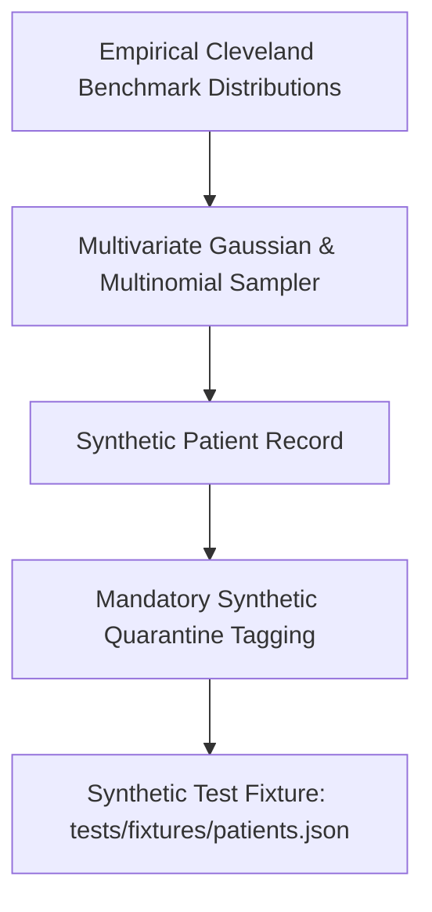

# TEST DATA MANAGEMENT AND PRIVACY PRESERVATION SPECIFICATION

**Document Reference:** `docs/quality/TEST_DATA_AND_PRIVACY_STRATEGY.md`  
**Phase:** 11 — Comprehensive Testing Strategy, Quality Assurance & Validation Framework  
**Status:** Approved Technical Architecture  
**Author:** Test Data Engineer & Healthcare Privacy Compliance Specialist  
**Traceability:** NFR-PRIV-01, NFR-SEC-01 through NFR-SEC-09, ADR-011  

---

## 1. Executive Summary & Zero Real PHI Policy

In healthcare technology systems, using production patient data for testing or staging purposes violates international privacy statutes (India DPDP Act 2023, EU GDPR Article 9, US HIPAA Privacy Rule) and represents a severe breach risk. 

HeartXAI 2.0 enforces a strict **Zero Real PHI Mandate**:
1. Non-production environments (development, CI testing, staging) utilize **100% synthetically generated patient cohorts**.
2. All synthetic data carries permanent, immutable metadata flags preventing it from ever being confused with real clinical records.
3. Test datasets are reproducible, version-controlled, and generated from statistical distributions matching historical benchmarks.

---

## 2. Synthetic Patient Data Generation Methodology

Synthetic patient records are generated using an automated utility (`scripts/generate_synthetic_patients.py`) that models multivariate distributions derived from the UCI Cleveland Clinic benchmark:



### 2.1 Clinical Biomarker Generation Rules:
- **Continuous Features:** Sampled from bounded truncated Gaussian distributions matching observed clinical ranges:
  - Age: $\mathcal{N}(54.4, 9.0)$, clamped to $[29, 77]$
  - Resting Blood Pressure: $\mathcal{N}(131.6, 17.5)$, clamped to $[94, 200]\text{ mmHg}$
  - Serum Cholesterol: $\mathcal{N}(246.3, 51.8)$, clamped to $[126, 564]\text{ mg/dL}$
  - Maximum Heart Rate: $\mathcal{N}(149.6, 22.9)$, clamped to $[71, 202]\text{ bpm}$
  - ST Depression: Exponential distribution $\lambda = 0.96$, clamped to $[0.0, 6.2]\text{ mm}$
- **Categorical Features:** Sampled via empirical multinomial probabilities maintaining observed conditional correlations (e.g. higher frequency of typical angina in elderly males).

---

## 3. Mandatory Synthetic Data Tagging & Quarantine

Every generated test record is permanently marked with synthetic provenance:
```json
{
  "is_synthetic": true,
  "data_provenance": "SYNTHETIC_GENERATOR_V1",
  "mrn": "SYN-TEST-2026-0042",
  "first_name": "Synthetic",
  "last_name": "Patient Alpha",
  "email": "synthetic.patient.0042@example.internal",
  "biomarkers": {
    "age": 58.0,
    "sex": 1.0,
    "cp": 3.0,
    "trestbps": 140.0,
    "chol": 240.0,
    "fbs": 0.0,
    "restecg": 0.0,
    "thalach": 160.0,
    "exang": 0.0,
    "oldpeak": 1.2,
    "slope": 1.0,
    "ca": 0.0,
    "thal": 3.0
  }
}
```

### 3.1 Hardened Database Safeguards:
1. **Quarantine Check Constraint:** In staging and development databases, a check constraint verifies `is_synthetic = TRUE`.
2. **Email Domain Blacklist:** All synthetic user email addresses use non-routable, reserved test domains (`@example.internal`, `@test.heartxai.org`), preventing automated test suites from ever emailing real external individuals.

---

## 4. Test Fixture Management & Deterministic Seeding

- **Static JSON Fixtures:** Core unit and integration test fixtures reside in version control under `backend/tests/fixtures/` and `frontend/tests/fixtures/`.
- **Factory Boy Integration:** Dynamic test objects are constructed using Factory Boy (`UserFactory`, `PredictionFactory`), guaranteeing random yet valid attribute generation across test runs.
- **Database Teardown & Reset:** Test suites run inside isolated database transactions (`session.begin_nested()`) that automatically rollback after test completion, ensuring complete test independence with zero residual data bleed.
