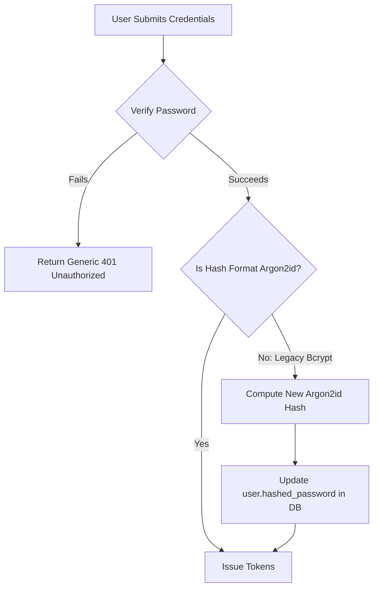
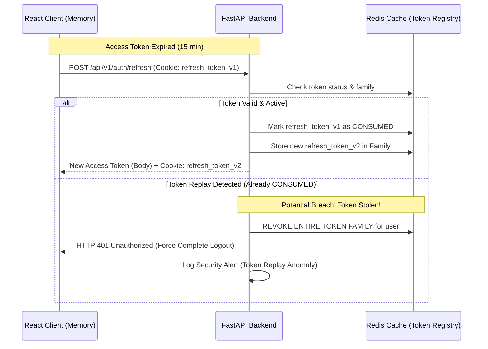

# AUTHENTICATION AND IDENTITY SECURITY DESIGN

**Document Reference:** `docs/security/AUTHENTICATION_SECURITY_DESIGN.md`  
**Phase:** 09 — Security, Privacy, Data Protection & Threat Modelling  
**Status:** Approved Technical Design  
**Author:** Identity & Access Management Architect  
**Traceability:** FR-AUTH-01 through FR-AUTH-05, NFR-SEC-01, NFR-SEC-02, ADR-009, ADR-011  

---

## 1. Executive Summary & Paradigm Selection

Authentication in healthcare applications demands strict defense against account takeover, credential stuffing, session hijacking, and session fixation. 

A primary architectural decision in identity systems is choosing between:
1. **Pure Stateful Server-Managed Sessions (e.g. Session Cookies backed by Redis/DB).**
2. **Pure Stateless JWTs (tokens held in client storage, signed by asymmetric/symmetric keys).**
3. **Hybrid Architecture: Short-Lived In-Memory Access JWTs + Statefully Tracked, Rotated Refresh Tokens in HttpOnly Cookies.**

### 1.1 Architectural Evaluation & Trade-off Matrix

| Criterion | Pure Server Sessions | Pure Stateless JWTs | Hybrid Architecture (Recommended) |
| :--- | :--- | :--- | :--- |
| **Instant Token Revocation** | Immediate (delete session key) | Impossible without distributed denylists | **Immediate** (revoke refresh token in Redis; access token expires in $\le 15$ min) |
| **Horizontal Scalability** | Requires central cache (Redis) for every request | High (zero database lookups per request) | **High** (access token verified statelessly by API workers; Redis queried only on 15-min refresh) |
| **XSS Vulnerability** | High if cookies lack HttpOnly; Low with HttpOnly | Critical if stored in `localStorage` | **Low** (Refresh cookie is `HttpOnly`; access token stored strictly in React memory) |
| **CSRF Vulnerability** | Moderate (requires CSRF tokens) | None if passed in Authorization header | **Immune** (Access token sent via `Authorization: Bearer`; Refresh cookie uses `SameSite=Strict`) |
| **Session Invalidation on Password Change** | High | Low (stateless tokens remain valid until expiration) | **High** (Redis invalidates all active user refresh token families immediately) |

### 1.2 Approved Architectural Decision
HeartXAI 2.0 adopts the **Hybrid Architecture**:
- **Access Tokens:** Short-lived JSON Web Tokens ($15\text{-minute}$ expiration) signed with HMAC-SHA256 (`HS256`) or RSA-256 (`RS256`), maintained strictly in client memory (React state). Never written to `localStorage`, `sessionStorage`, or IndexedDB.
- **Refresh Tokens:** Long-lived opaque cryptographically random tokens ($7\text{-day}$ expiration) stored in `HttpOnly`, `Secure`, `SameSite=Strict` cookies, with stateful family tracking and revocation lists in Redis.

---

## 2. Password Hashing Specification: Argon2id Migration

While the Phase 3 prototype initialized with `bcrypt` (12 rounds in `app/core/security.py`), Argon2id is the gold standard for password hashing (winner of the Password Hashing Competition, RFC 9106), providing superior resistance to GPU-accelerated and ASIC-based offline attacks through memory-hard operations.

### 2.1 Argon2id Target Parameters

```python
# Canonical Argon2id Production Configuration
ARGON2_CONFIG = {
    "memory_cost": 65536,     # 64 MB RAM
    "time_cost": 3,           # 3 iterations
    "parallelism": 4,         # 4 parallel lanes / threads
    "hash_len": 32,           # 256-bit output hash
    "salt_len": 16            # 128-bit cryptographically secure random salt
}
```

### 2.2 Transparent Backward-Compatible Migration Strategy
To avoid forcing all existing users to reset passwords, the authentication service implements an in-flight re-hashing upgrade pipeline:



---

## 3. Refresh Token Rotation (RTR) & Revocation Architecture

To prevent stolen refresh tokens from providing perpetual access, HeartXAI implements **Refresh Token Rotation (RFC 6749 Section 6)** with automatic reuse detection:



### Cookie Security Attributes:
- `HttpOnly`: Accessible only to the HTTP protocol; JavaScript `document.cookie` cannot read the token.
- `Secure`: Cookie transmitted strictly over HTTPS (encrypted in transit).
- `SameSite=Strict`: Cookie never sent in cross-site contexts, eradicating CSRF vectors.
- `Path=/api/v1/auth`: Cookie scoped strictly to authentication refresh/logout routes.

---

## 4. Account Enumeration Prevention

Attackers exploit registration, login, and password reset interfaces to determine whether an email exists in the system. HeartXAI enforces uniform responses and timing:

1. **Uniform Response Messages:**
   - **Login Failure:** Always returns `HTTP 401 Unauthorized` with message: `"Invalid email or password."` (Never `"Email not found"` or `"Incorrect password"`).
   - **Registration with Existing Email:** Always returns `HTTP 200 OK` with message: `"If an account does not exist with this email, a verification link has been sent."` The system internally sends an informational email: *"An attempt was made to register an account with your email. If this was you, please sign in."*
   - **Password Reset:** Always returns `HTTP 200 OK` with message: `"If that email address is in our database, we have sent a password reset link to it."`
2. **Constant-Time Operations:**
   - If an email does not exist during login, the backend executes a dummy Argon2id hash verification against a static pre-computed hash to prevent timing attacks.

---

## 5. Brute Force Defense & Rate Limiting

Rate limiting is enforced at both the reverse proxy (Nginx/Cloudflare) and application tier (Redis sliding window):

```python
# Authentication Rate Limits
RATE_LIMIT_LOGIN_IP = "20/minute"           # Per IP address
RATE_LIMIT_LOGIN_USER = "5/15 minutes"       # Per email account
RATE_LIMIT_REGISTER_IP = "5/hour"           # Per IP address
RATE_LIMIT_RESET_REQUEST = "3/hour"         # Per email account
```

- **Lockout Mechanism:** 5 consecutive failed logins for an account triggers a 15-minute lockout. An email notification is automatically dispatched to the account owner alerting them to suspicious activity.

---

## 6. Password Reset & Account Recovery Security

1. **Token Generation:** 32-byte cryptographically secure random token (`secrets.token_urlsafe(32)`), providing 256 bits of entropy.
2. **Database Storage:** The raw token is **never** stored in the database. Only the SHA-256 digest of the token is stored (`reset_token_hash`), preventing compromised database backups from exposing active reset links.
3. **Strict Ephemerality:** Expiration strictly enforced at 15 minutes.
4. **Single-Use Enforcement:** The reset token is immediately deleted or marked `used = True` upon password update.
5. **Session Invalidation:** Successful password reset triggers immediate revocation of all active refresh tokens in Redis, terminating all existing sessions across all browsers.

---

## 7. Multi-Factor Authentication (MFA / 2FA) Design

HeartXAI specifies Time-Based One-Time Password (TOTP) compliant with RFC 6238 (compatible with Google Authenticator, Authy, 1Password):
- **Algorithm:** HMAC-SHA1 or HMAC-SHA256, 6-digit code, 30-second time step, $\pm 1$ window skew tolerance.
- **Secret Storage:** TOTP secret keys are encrypted in the PostgreSQL database using application-level AES-256-GCM.
- **Recovery Codes:** Upon enabling MFA, the user receives 10 single-use backup recovery codes (each 16 characters), stored in the database as individual Argon2id hashes.
- **Administrative Enforcement:** MFA is mandatory for all user accounts possessing the `ADMIN` role.

---

## 8. Session Invalidation on Sensitive Account Changes

When a user executes any of the following sensitive actions, the backend invokes `auth_service.revoke_all_user_sessions(user_id)`:
1. Password change or reset.
2. Email address change.
3. MFA activation or deactivation.
4. Explicit "Log out of all devices" request.

The revocation sets a Redis key `user_revoked_at:{user_id} = timestamp`. When any access token issued prior to that timestamp attempts access, the API dependency rejects it with `HTTP 401 Unauthorized`.
