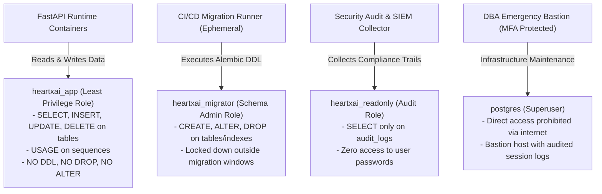
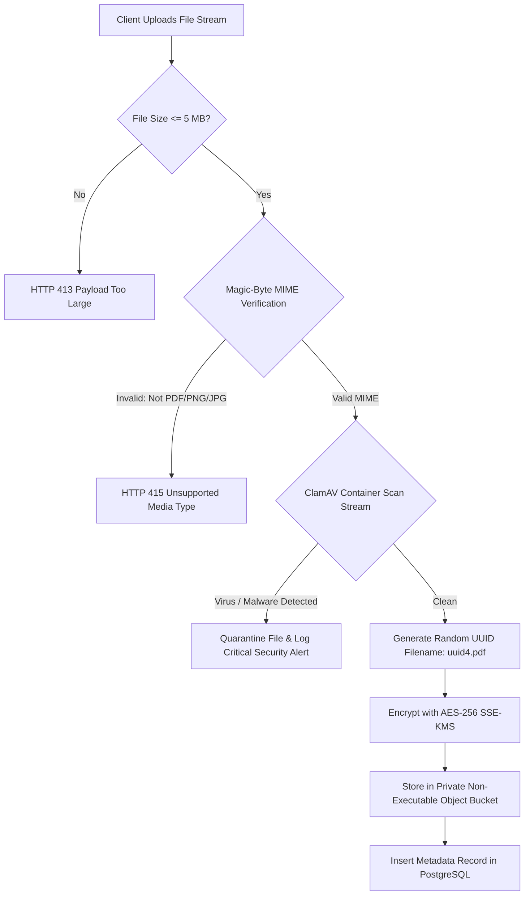

# DATABASE AND FILE STORAGE SECURITY SPECIFICATION

**Document Reference:** `docs/security/DATABASE_AND_FILE_SECURITY.md`  
**Phase:** 09 — Security, Privacy, Data Protection & Threat Modelling  
**Status:** Approved Technical Design  
**Author:** Database Security Architect & Storage Systems Specialist  
**Traceability:** NFR-SEC-01, NFR-SEC-04, NFR-SEC-08, ADR-009, ADR-011  

---

## 1. Executive Summary

This specification governs the security controls applied to HeartXAI 2.0's primary data storage engines: the PostgreSQL 15+ relational database and the private object storage pipeline handling clinical files (ECG tracings, diagnostic PDFs, and exported clinical assessment reports).

Data integrity, least-privilege access, authenticated encryption, isolation, and automated malware scanning are enforced across all persistence tiers.

---

## 2. PostgreSQL Security Architecture & Account Least Privilege

### 2.1 Role-Based Database User Segregation
To prevent an application compromise from escalating into a catastrophic schema drop or database reconfiguration, HeartXAI establishes four distinct PostgreSQL roles:



### 2.2 Strict Parameterization & SQL Injection Eradication
- All database queries must be generated using **SQLAlchemy 2.0 ORM** or explicitly parameterized expressions (`text("SELECT ... WHERE user_id = :uid")`).
- String concatenation, Python f-strings, and `.format()` inside database queries are strictly prohibited and flagged as blocking errors by static analysis rules in CI/CD.

### 2.3 Network & Transport Encryption
- Database connections run over private VPC subnets, inaccessible to the public internet.
- Transport encryption is mandatory:
  ```text
  sslmode=verify-full
  sslrootcert=/etc/ssl/certs/rds-combined-ca-bundle.pem
  ```
  Plaintext connections are rejected at the database listener level (`pg_hba.conf`).

---

## 3. Database Audit Logging & Tamper-Evident History

Mutations to clinical records and consent states are tracked via PostgreSQL database triggers into an append-only audit ledger (`audit_logs`):

```sql
-- Append-Only Security Trigger Example
CREATE OR REPLACE FUNCTION log_prediction_audit()
RETURNS TRIGGER AS $$
BEGIN
    INSERT INTO audit_logs (
        table_name,
        operation,
        record_id,
        user_id,
        old_state,
        new_state,
        changed_at
    ) VALUES (
        TG_TABLE_NAME,
        TG_OP,
        COALESCE(NEW.id, OLD.id),
        COALESCE(NEW.user_id, OLD.user_id),
        CASE WHEN TG_OP IN ('UPDATE', 'DELETE') THEN row_to_json(OLD) ELSE NULL END,
        CASE WHEN TG_OP IN ('INSERT', 'UPDATE') THEN row_to_json(NEW) ELSE NULL END,
        NOW() AT TIME ZONE 'UTC'
    );
    RETURN NEW;
END;
$$ LANGUAGE plpgsql SECURITY DEFINER;
```

The database role `heartxai_app` is granted `INSERT` and `SELECT` on `audit_logs`, with **zero** `UPDATE` or `DELETE` permissions, ensuring that application compromises cannot tamper with forensic history.

---

## 4. Backup Encryption & Restoration Verification Protocols

1. **Daily Encrypted Backups:** Full PostgreSQL dumps (`pg_dump`) execute nightly, piped through AES-256-GCM authenticated encryption before off-site replication to an immutable storage bucket with Object Lock (WORM - Write Once, Read Many).
2. **Key Nonce Management:** A unique 96-bit nonce is generated per backup file using `secrets.token_bytes(12)`.
3. **Restoration Testing Protocol:** An automated monthly restore drill runs in an isolated staging environment. The test loads the latest encrypted backup, performs cryptographic tag verification, restores the database schema, and validates data consistency via automated integrity checksums. A backup is not marked reliable until restore testing succeeds.

---

## 5. File Upload Pipeline & Malware Defense Sandbox

HeartXAI allows patients to upload supplemental medical documents (e.g. ECG tracings, lab reports). Unrestricted file uploads represent severe remote code execution (RCE) vectors.



### 5.1 Verification Tiers
1. **Magic-Byte MIME Verification:** Inspects the first 512 bytes of the file stream using `python-magic`. Files claiming to be `.pdf` but containing HTML/PHP/PE executable magic bytes are immediately rejected.
2. **Containerized Antivirus Sandbox:** The file stream is scanned via ClamAV daemon running in an isolated sidecar container before committing to persistent storage.
3. **Randomized UUID Filenames:** The original client filename is stripped and stored as display metadata only. The physical object is saved as `<uuid4>.<ext>`, eliminating directory traversal attacks (`../../etc/passwd`).
4. **Storage Isolation:** S3/Object store buckets are configured with `Block Public Access = True` and `ServerSideEncryption = aws:kms`. Direct public HTTP access is impossible.

---

## 6. Report Generation & Authorized Download Flow

When a patient or clinician generates a clinical assessment report:
1. **In-Memory Rendering:** The PDF is compiled in memory using ReportLab / Weasyprint without writing unencrypted temporary files to shared disk space.
2. **Temporary Storage:** If caching is required, the file is encrypted with AES-256-GCM and stored in a private bucket with a 24-hour expiration policy (Lifecycle Rule).
3. **Download Authorization:** Clients cannot access reports via static URLs. Downloads require invoking `GET /api/v1/reports/{id}/download`, where FastAPI verifies patient ownership or active clinician consent, then generates a **Presigned URL** valid for exactly 10 minutes.
4. **Temporary File Reaper:** A scheduled background worker checks `/tmp` every hour, securely shredding any orphaned temporary processing files (`shred -u`).
