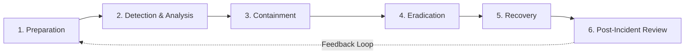

# INCIDENT RESPONSE AND DISASTER RECOVERY PLAN

**Document Reference:** `docs/security/INCIDENT_RESPONSE_AND_DISASTER_RECOVERY.md`  
**Phase:** 09 — Security, Privacy, Data Protection & Threat Modelling  
**Status:** Approved Technical Design  
**Author:** Incident Commander & Disaster Recovery Specialist  
**Traceability:** NFR-REL-01, NFR-SEC-01, NFR-PRIV-01, ADR-009, ADR-011  

---

## 1. Executive Summary

In healthcare operations, security incidents and system outages directly threaten patient trust, regulatory compliance, and clinical safety. HeartXAI 2.0 defines an operational Incident Response Plan (IRP) aligned with **NIST SP 800-61 Rev. 2** (Computer Security Incident Handling Guide), paired with a Disaster Recovery and Business Continuity Plan (DR/BCP) guaranteeing rapid containment, data integrity, and forensic transparency.

### Core Recovery Metrics:
- **Recovery Point Objective (RPO):** $\le 1\text{ hour}$ (maximum permissible data loss window).
- **Recovery Time Objective (RTO):** $\le 4\text{ hours}$ (maximum permissible service downtime to full restoration).

---

## 2. Six-Phase Incident Response Lifecycle (NIST SP 800-61 Alignment)

### Phase 1: Preparation
- Pre-configured forensic tooling, central SIEM access, incident war room bridges, and predefined communication templates for regulatory reporting and patient notices.

### Phase 2: Detection & Analysis (Triage)
- **Triage Matrix:** Incidents categorized by severity:
  - **SEV-1 (Critical):** Confirmed active breach of patient PHI, database compromise, or ransomware deployment. Incident Commander mobilization within 15 minutes.
  - **SEV-2 (High):** Account takeover of administrative credentials, active brute force / DoS attack, or malicious file upload attempt. Response within 1 hour.
  - **SEV-3 (Medium):** Localized rate-limit violation, single user credential abuse, non-exploitable vulnerability report. Response within 8 hours.

### Phase 3: Containment
- **Short-Term Containment:** Isolate compromised worker container; terminate affected database connection pool; revoke user sessions via Redis cache purge; update WAF firewall rules to block attacking IP addresses.
- **Long-Term Containment:** Temporarily route traffic to a static maintenance page while database snapshots are captured for forensic analysis.

### Phase 4: Eradication
- Identify root cause (e.g. vulnerable dependency, stolen token, misconfigured bucket policy).
- Rotate all compromised credentials, revoke affected tokens, purge malicious files from object storage, and deploy emergency hotfix patches.

### Phase 5: Recovery
- Restore verified database state from clean encrypted snapshot if corruption occurred.
- Validate system integrity via automated smoke tests; restore production traffic progressively ($10\% \rightarrow 50\% \rightarrow 100\%$).
- Maintain continuous elevated monitoring for 72 hours.

### Phase 6: Post-Incident Review (Lessons Learned)
- Comprehensive Root Cause Analysis (RCA) completed within 5 business days.
- Update threat models, security requirements, and CI/CD rules to prevent recurrence.

---

## 3. Threat-Specific Incident Playbooks

### Playbook A: Patient Health Data (PHI) Exposure / Leakage
1. **Immediate Action:** Identify leaked endpoint / payload. Block route or disable exposed bucket via WAF rule.
2. **Scoping:** Query `audit_logs` using correlation IDs to identify exactly which patient records were queried, the originating IP addresses, and timestamps.
3. **Regulatory Notification:**
   - **India (DPDP Act):** Notify Data Protection Board and affected Data Principals per Section 8(6).
   - **EU (GDPR):** Report to competent supervisory authority within **72 hours** under Article 33.
   - **US (HIPAA/HHS):** If serving a US Covered Entity, notify Entity within 24 hours to initiate Breach Notification Rule compliance.

### Playbook B: Database Ransomware or Malicious Data Tampering
1. **Immediate Action:** Instantly sever database network connectivity (isolate security group).
2. **Containment:** Terminate all active FastAPI instances to freeze database state.
3. **Assessment:** Verify whether ciphertext encryption keys remain intact or database volumes were encrypted by malware.
4. **Restoration:** Spin up a new PostgreSQL instance in an isolated VPC. Restore from the latest verified off-site AES-256-GCM encrypted backup snapshot. Verify row integrity and replay tamper-evident audit logs.

### Playbook C: Malicious File Upload Compromise
1. **Immediate Action:** Quarantined file deleted from storage bucket.
2. **Container Recycle:** Terminate and replace the backend container that processed the upload to eliminate in-memory rootkits.
3. **Firewall Rule:** Block client IP and user account.

---

## 4. Disaster Recovery & Backup Architecture

> [!IMPORTANT]
> **Validation Principle:**  
> Backups are treated as **untrusted and unverified** until full restoration testing has been successfully executed.

### 4.1 Backup Schedule & Multi-Region Topology
- **PostgreSQL Database:**
  - Automated continuous Write-Ahead Log (WAL) archiving (supporting point-in-time recovery to within 5 minutes).
  - Nightly full logical snapshots (`pg_dump`) encrypted with AES-256-GCM.
- **Physical File & Model Storage:**
  - Continuous bucket replication to a secondary geographically separated cloud region with Object Lock (WORM).
- **Retention Period:** Daily backups retained for 30 days; weekly archives retained for 12 weeks; monthly compliance archives retained for 7 years in cold archive (AWS Glacier / GCS Archive).

### 4.2 Automated Restoration Drill Protocol
Every quarter, an automated script executes a **Disaster Recovery Rehearsal**:
1. Spawns an isolated temporary VPC.
2. Retrieves the latest encrypted backup archive from secondary storage.
3. Decrypts ciphertext using KMS keys, verifying the 16-byte GCM authentication tag.
4. Restores database schema and executes data integrity queries (asserting record counts, hash consistency, and index validity).
5. Logs execution metrics ($\text{RTO}$ time taken, byte counts) to the compliance register.
