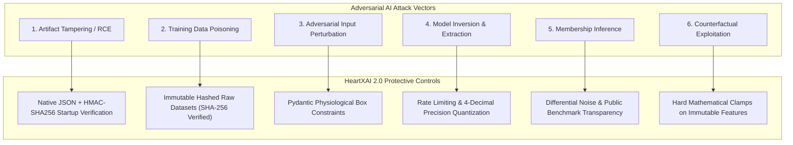

# MACHINE LEARNING SUBSYSTEM SECURITY SPECIFICATION

**Document Reference:** `docs/security/MACHINE_LEARNING_SECURITY.md`  
**Phase:** 09 — Security, Privacy, Data Protection & Threat Modelling  
**Status:** Approved Technical Design  
**Author:** AI Security Researcher & ML Systems Architect  
**Traceability:** FR-PRED-*, NFR-SEC-01 through NFR-SEC-09, ADR-009, ADR-011  

---

## 1. Executive Summary & AI Attack Surface

Machine learning systems in healthcare present novel attack vectors that standard application firewalls cannot detect. Adversaries can exploit statistical decision boundaries, poison training sets, reverse-engineer model weights, infer sensitive training membership, or tamper with serialized artifacts.

HeartXAI 2.0 establishes a comprehensive defense framework governing model serialization, cryptographic artifact provenance, adversarial boundary validation, explanation differential privacy, and safe counterfactual execution.

> [!WARNING]
> **Adversarial Robustness Disclaimer:**  
> HeartXAI 2.0 does **not** claim complete immunity to adversarial machine learning attacks. Tree-based ensembles and non-linear classifiers inherently possess vulnerable boundary regions. This specification establishes defense-in-depth mitigations designed to minimize attack feasibility and detect anomalous input exploitation.

---

## 2. ML Attack Taxonomy & Architectural Mitigations

---

## 3. Model Artifact Integrity, Safe Serialization & Loading

### 3.1 The Insecure Deserialization Vulnerability
Python's standard `pickle` module allows arbitrary code execution during deserialization. If an attacker replaces an artifact file with a pickled payload, the server executes arbitrary shell commands upon invoking `pickle.load()`.

### 3.2 Approved Safe Serialization Architecture
1. **Tree Ensembles (XGBoost):** Serialized strictly via native JSON format (`booster.save_model("cleveland_xgboost_v1.0.0.json")`), which contains purely structural tree weights and zero executable bytecode.
2. **Tabular Medoid Arrays:** Serialized as uncompressed NumPy `.npy` files verified with strict header dimensions.
3. **Scikit-Learn Preprocessors (Scalers/Imputers):** Where `joblib` is strictly required, the artifact is paired with a detached cryptographic signature:
   $$\text{Signature} = \text{HMAC-SHA256}(\text{Artifact Bytes}, K_{\text{ML\_SIGNING\_KEY}})$$
   At application startup, `app/ml/engine.py` re-computes the HMAC signature. If the computed digest does not match the manifest signature, startup aborts immediately with `ModelIntegrityException`.

---

## 4. Adversarial Input Defense & Physiological Clamping

Adversaries may attempt gradient-based perturbation attacks (e.g. HopSkipJump or boundary attacks on tabular trees) to find minimal feature perturbations that artificially flip a high-risk prediction to low-risk without triggering clinical suspicion.

### 4.1 Multi-Layered Boundary Validation
1. **Strict Type & Schema Enforcement:** Pydantic V2 rejects non-numeric, infinite (`inf`), or `NaN` inputs.
2. **Physiological Hard Clamps:** Every continuous biomarker is bounded by physiologically survivable ranges:
   - Systolic BP: $[80, 240]\text{ mmHg}$
   - Cholesterol: $[100, 600]\text{ mg/dL}$
   - Maximum HR: $[60, 220]\text{ bpm}$
   - ST Depression: $[0.0, 10.0]\text{ mm}$
3. **Internal Correlation Checks:** The preprocessing pipeline flags medically contradictory input vectors (e.g., age $22$ with $3$ severely calcified fluoroscopy vessels) and logs an anomalous inference warning.

---

## 5. Model Inversion, Extraction & Explanation Leakage

### 5.1 Model Stealing / Extraction Prevention
Attackers can query `/api/v1/predictions` thousands of times to reconstruct an empirical surrogate model that duplicates HeartXAI's proprietary decision logic without paying or authenticating:
- **Mitigation 1 (Rate Limiting):** Authenticated prediction queries are strictly capped at 10 requests per minute per user, preventing automated high-density boundary probing.
- **Mitigation 2 (Precision Quantization):** Calibrated probabilities and SHAP attributions are rounded to 4 decimal places. Stripping micro-variations introduces sufficient information loss to break equation-solving model reconstruction algorithms.

### 5.2 Membership Inference Defense
Membership inference attacks attempt to determine whether a specific patient was part of the original training cohort by analyzing prediction confidence spikes:
- HeartXAI's primary training data is the **UCI Cleveland open benchmark** ($N=303$), which is already a publicly accessible research dataset. No confidential proprietary patient data is utilized in primary model weights.
- When future fine-tuning on proprietary clinical data occurs, models must undergo differential privacy verification ($\epsilon \le 3.0$) before production promotion.

---

## 6. Counterfactual Safety & Algorithmic Manipulation

Unchecked counterfactual optimizers can recommend harmful or physiologically impossible lifestyle modifications:
1. **Immutable Baseline Clamps:** Age, Sex, and Fluoroscopy vessel count (`ca`) are mathematically locked ($\Delta x_j = 0$). The optimizer is mathematically barred from suggesting a patient become younger or reverse calcified arterial lesions.
2. **Physiological Floor Clamps:** Actionable vitals are bounded by physiological floors (e.g. resting blood pressure cannot be reduced below $90\text{ mmHg}$).
3. **Clinical Guardrail Disclaimers:** All counterfactual outputs are explicitly tagged as mathematical sensitivity analysis, accompanied by mandatory disclaimers prohibiting patients from altering medication doses without physician consultation.
