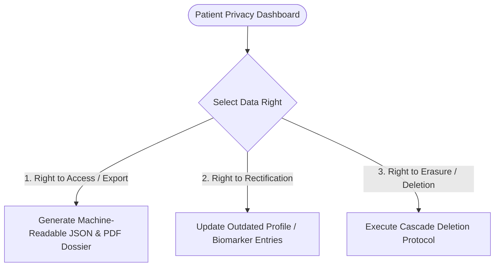
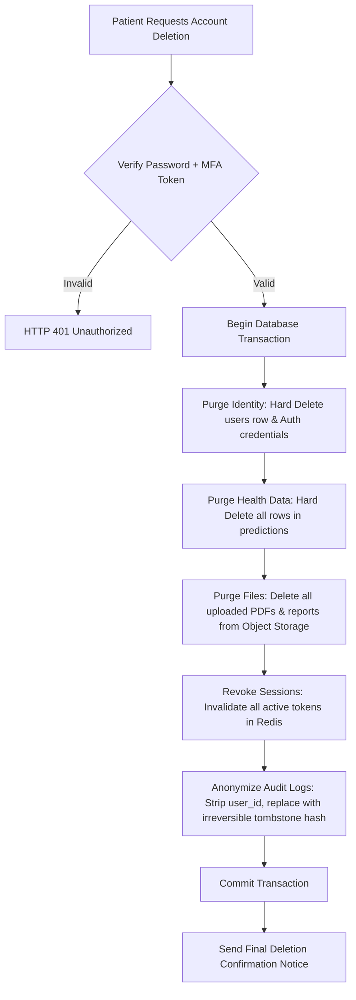

# PRIVACY BY DESIGN AND CONSENT MANAGEMENT SPECIFICATION

**Document Reference:** `docs/security/PRIVACY_BY_DESIGN_AND_CONSENT.md`  
**Phase:** 09 — Security, Privacy, Data Protection & Threat Modelling  
**Status:** Approved Technical Design  
**Author:** Privacy by Design Consultant & Data Governance Lead  
**Traceability:** FR-USER-*, NFR-PRIV-01, ADR-009, ADR-011  

---

## 1. Executive Summary & Foundational Principles

Privacy is a fundamental human right and a core engineering constraint. HeartXAI 2.0 adopts the internationally recognized **7 Foundational Principles of Privacy by Design (PbD)** established by Dr. Ann Cavoukian:
1. **Proactive not Reactive; Preventative not Remedial**
2. **Privacy as the Default Setting**
3. **Privacy Embedded into Design**
4. **Full Functionality — Positive-Sum, not Zero-Sum**
5. **End-to-End Security — Full Lifecycle Protection**
6. **Visibility and Transparency — Keep it Open**
7. **Respect for User Privacy — Keep it User-Centric**

---

## 2. Lawful Bases for Processing & Purpose Limitation

A critical legal and engineering requirement is acknowledging that **consent is not the universal legal basis for all processing activities**:

| Processing Activity | Data Category | Lawful Basis (GDPR / DPDP) | Necessity Status | Unbundled Choice? |
| :--- | :--- | :--- | :---: | :---: |
| **Account Creation & Security** | Email, Name, Password Hash | Contractual Necessity (Art. 6(1)(b)) / Legitimate Purpose | Mandatory | Bundled with Terms of Service |
| **Core Cardiovascular Risk Prediction** | 13 Clinical Biomarkers | Explicit Consent for Health Data (Art. 9(2)(a)) | Mandatory for ML Feature | Granular Consent Gate |
| **Doctor / Hospital Directory Search** | Geolocation (City/Region), Doctor specialty | Legitimate Interests (Art. 6(1)(f)) | Optional | No tracking; query-time only |
| **Sharing Report with Doctor** | Clinical Summary PDF, Biomarkers | Explicit User Delegation Consent | Optional | Explicit Time-Bounded Grant |
| **Secondary Research & Model Tuning** | Anonymized Historical Biomarkers | Explicit Voluntary Research Consent | Optional | Completely Unbundled Opt-In |
| **Security Audit & Fraud Prevention** | IP address, User-Agent, Access logs | Legal Obligation / Legitimate Interest | Mandatory | Non-consent based (7-yr retention) |

---

## 3. Granular Consent Management Architecture

Consent in HeartXAI is never collected via pre-ticked checkboxes or opaque multi-page agreements. It is granular, unbundled, time-stamped, versioned, and revocable.

### 3.1 Database Consent Ledger (`user_consents` table)
```sql
CREATE TABLE user_consents (
    id SERIAL PRIMARY KEY,
    user_id INTEGER NOT NULL REFERENCES users(id) ON DELETE CASCADE,
    consent_type VARCHAR(50) NOT NULL, -- 'HEALTH_DATA_PROCESSING', 'RESEARCH_OPT_IN', 'CLINICIAN_SHARE'
    version VARCHAR(20) NOT NULL,      -- 'v1.0_2026_11'
    granted BOOLEAN NOT NULL,
    granted_at TIMESTAMP WITH TIME ZONE NOT NULL DEFAULT NOW(),
    revoked_at TIMESTAMP WITH TIME ZONE,
    ip_address_hash VARCHAR(64) NOT NULL,
    user_agent VARCHAR(255) NOT NULL
);
```

### 3.2 Dynamic Consent Withdrawal Pipeline
When a patient toggles consent off in their privacy settings (`POST /api/v1/consent/withdraw`):
1. The `user_consents` record is updated with `granted = False` and `revoked_at = NOW()`.
2. Any active clinician sharing grants linked to that consent type are instantly revoked.
3. The platform immediately terminates secondary processing without affecting the patient's core account access.

---

## 4. Data Subject Rights & Automated Lifecycle Workflows

HeartXAI provides automated self-service endpoints allowing patients to exercise their legal data rights without manual administrative ticketing:



### 4.1 Right to Access & Data Portability (DSAR)
- Endpoint: `POST /api/v1/privacy/export`
- Payload Delivered: A password-protected ZIP archive containing:
  - `patient_profile.json` (account metadata, contact info)
  - `clinical_prediction_history.json` (all past biomarker inputs, calculated risk scores, and SHAP vectors)
  - `consent_audit_history.json` (full record of all granted/revoked consents)
  - Exported PDF summaries of all past assessments.

---

## 5. Account Deletion & Right to be Forgotten Protocol

When a patient initiates account deletion (`DELETE /api/v1/users/me`), the backend executes an irreversible, transactional multi-stage purge:



### 5.1 Handling Artifacts Across Subsystems:
1. **Live PostgreSQL Database:** Hard deletion of all user records, predictions, uploaded document metadata, and consent records via foreign key cascading (`ON DELETE CASCADE`).
2. **Object Storage (S3):** Asynchronous worker deletes all physical files in the private bucket under `uploads/{user_id}/*` and `reports/{user_id}/*`.
3. **Database Backups:** Backups are encrypted snapshots retained for 30 days for disaster recovery. It is technically impossible and unsafe to selectively edit encrypted tape/block backups. Under global privacy guidance (EDPB & Indian DPDP), backups are permitted to expire naturally through standard 30-day lifecycle retention. If a backup is ever restored, an automated post-restore script re-applies the deletion tombstone log.
4. **Append-Only Audit Logs:** In accordance with statutory legal requirements (healthcare fraud prevention and security forensics), audit logs are retained for 7 years. However, all personal identifiers (`user_id`, email, name) are permanently replaced with an irreversible pseudonym hash (`SHA256(user_id + global_salt)`), ensuring the log proves an event occurred without identifying the individual.
5. **Machine Learning Models:** Because models are trained exclusively on open benchmark datasets (UCI Cleveland), production model weights contain zero patient personal data. If consensual de-identified patient data is used in future fine-tuning, the data undergoes irreversible k-anonymity ($k \ge 5$) and differential privacy before training, preventing individual record reconstruction.
