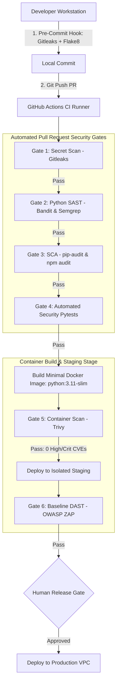

# SECURE DEVELOPMENT LIFECYCLE (DEVSECOPS) SPECIFICATION

**Document Reference:** `docs/security/SECURE_DEVELOPMENT_LIFECYCLE.md`  
**Phase:** 09 — Security, Privacy, Data Protection & Threat Modelling  
**Status:** Approved Technical Design  
**Author:** DevSecOps Architect & Quality Engineering Lead  
**Traceability:** NFR-MAINT-01, NFR-SEC-01 through NFR-SEC-09  

---

## 1. Executive Summary & DevSecOps Philosophy

Security cannot be treated as a manual gate applied right before release. In modern software engineering, vulnerabilities must be identified and mitigated at the earliest possible phase of the development lifecycle (Shift-Left Security).

HeartXAI 2.0 embeds security checks into every phase of the CI/CD pipeline:
- **Phase 1: Local Pre-Commit** (Secret scanning, code style, linter rules).
- **Phase 2: Pull Request CI Gate** (SAST, SCA dependency audits, unit security tests).
- **Phase 3: Build & Packaging** (Container vulnerability scanning, SBOM generation).
- **Phase 4: Staging Deployment** (Automated baseline DAST, configuration audits).
- **Phase 5: Production Release** (Cryptographic signing, release readiness gate).

---

## 2. DevSecOps Tooling Matrix, Purpose & Limitations

To avoid "tool inflation" (adding tools that create noisy alerts without actionable remediation), HeartXAI selects five specialized, high-fidelity security tools:

| Category | Selected Tool | Specific Purpose in HeartXAI | Architectural Limitations & Compensating Controls |
| :--- | :--- | :--- | :--- |
| **Secret Scanning** | **Gitleaks** | Scans Git commits and staged files for passwords, API keys, private keys, and JWT secrets using regex and entropy rules. | *Limitation:* Cannot detect non-standard proprietary secrets. *Compensating Control:* Developer education and strict code reviews. |
| **Python SAST** | **Bandit** | Analyzes Python AST for common flaws: unsafe `pickle.load()`, hardcoded `/tmp` paths, weak cryptography (MD5/SHA1), dynamic SQL. | *Limitation:* Context-blind; creates false positives on test code. *Compensating Control:* Targeted config excluding `tests/` directory. |
| **Semantic SAST** | **Semgrep** | Custom rule engine enforcing HeartXAI security standards: verifying Pydantic models on routes, blocking `dangerouslySetInnerHTML`. | *Limitation:* Requires ongoing maintenance of custom rule YAMLs. *Compensating Control:* Standard OWASP Semgrep rulesets. |
| **Dependency SCA** | **pip-audit** & **npm audit** | Scans Python wheels and React npm packages against the National Vulnerability Database (NVD) and GitHub Advisory Database. | *Limitation:* Only identifies known CVEs; blind to zero-days. *Compensating Control:* Lockfile pinning (`uv.lock`, `package-lock.json`). |
| **Container Scanning**| **Trivy** | Scans production Docker container base images (`python:3.11-slim`) for OS-level package vulnerabilities (OpenSSL, glibc). | *Limitation:* Does not analyze application runtime logic. *Compensating Control:* Paired with application SAST and minimal images. |
| **Baseline DAST** | **OWASP ZAP (Baseline)**| Executes passive and active automated security scans against staging REST endpoints (CORS headers, cookie flags, injection). | *Limitation:* Cannot navigate complex authenticated stateful flows. *Compensating Control:* Automated Pytest API security suites. |

---

## 3. CI/CD Security Pipeline Architecture

---

## 4. Release Blocker Criteria & Vulnerability Management

Security issues identified during CI/CD execution are categorized via CVSS v3.1 scores:

| Severity Level | CVSS Score Range | Maximum Permitted in Release | Remediation SLA |
| :--- | :---: | :---: | :---: |
| **Critical** | $9.0 - 10.0$ | **ZERO (Release Blocker)** | Immediate halt; fix within 24 hours |
| **High** | $7.0 - 8.9$ | **ZERO (Release Blocker)** | Fix within 72 hours |
| **Medium** | $4.0 - 6.9$ | $\le 3$ (With documented compensating control) | Fix within next sprint (14 days) |
| **Low / Informational** | $0.1 - 3.9$ | Permitted | Routine backlog triage |

> [!IMPORTANT]
> **No Silent Overrides:**  
> A build that fails a Critical or High security gate cannot be overridden by an individual engineer. Overriding a blocked pipeline requires formal written risk acceptance signed by both the Lead Architect and Security Lead.

---

## 5. Secure Coding Standards

1. **Python / FastAPI Standards:**
   - 100% of endpoints must declare explicit response models.
   - All database interactions must use SQLAlchemy 2.0 ORM expressions or bind parameters.
   - Never utilize `eval()`, `exec()`, or unvalidated `__import__()`.
   - Never load arbitrary data using `pickle.load()` on network streams.
2. **React / TypeScript Standards:**
   - Strict TypeScript (`"strict": true` in `tsconfig.json`).
   - Zero use of `dangerouslySetInnerHTML`.
   - Never store tokens or health metrics in `localStorage`.
   - All dynamic external links must declare `rel="noopener noreferrer"`.
