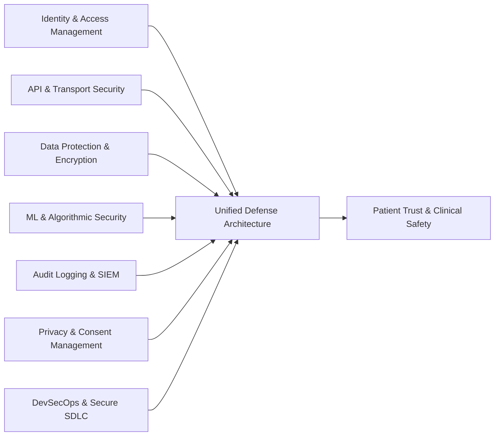

# HEARTXAI 2.0 — SECURITY AND PRIVACY ARCHITECTURE

**Document Reference:** `docs/security/SECURITY_AND_PRIVACY_ARCHITECTURE.md`  
**Phase:** 09 — Security, Privacy, Data Protection & Threat Modelling  
**Status:** Approved Technical Architecture  
**Author:** Principal Application Security Architect & Privacy-by-Design Consultant  
**Traceability:** NFR-SEC-01 through NFR-SEC-09, NFR-PRIV-01, ADR-009, ADR-011  

---

## 1. Executive Summary & Security Philosophy

HeartXAI 2.0 is an enterprise-grade Clinical Decision Support (CDS) platform processing sensitive patient identities, clinical biomarkers, machine learning risk assessments, explainability vectors, and healthcare provider directory interactions. In healthcare technology, security and privacy cannot be retrofitted as superficial checkboxes onto an insecure baseline. Security must be an inherent architectural property engineered into every layer from inception.

HeartXAI 2.0 adheres to five foundational architectural principles:
1. **Zero Trust Architecture (ZTA):** No network boundary, microservice, internal caller, or user role is implicitly trusted. Every inbound request undergoes cryptographic authentication, granular authorization, and strict schema validation.
2. **Defense-in-Depth:** Multiple independent, layered controls protect every asset. If a perimeter barrier fails (e.g., reverse proxy misconfiguration), internal controls (API parameterization, database row-level security, column encryption) prevent data compromise.
3. **Privacy by Design & Default (PbD):** Data collection is strictly minimized. Data protection measures are built directly into data ingestion, processing, and storage lifecycles without requiring patient intervention.
4. **Patient Data Sovereignty:** Patients maintain absolute ownership of their personal health information. Healthcare professionals cannot browse general patient records; access requires explicit, granular, time-bounded consent grants.
5. **Decoupled Global Security & Country Localization (ADR-011):** Core security mechanisms (cryptographic primitives, session token handling, RBAC/ABAC guards) are globally standardized, while privacy legal bases, consent notices, and regulatory compliance adapters are modularly configured per country.

---

## 2. Trust Boundaries & Multi-Tier Network Zones

The system architecture partitions infrastructure into five isolated security zones separated by authenticated, firewalled trust boundaries:

```mermaid
graph TB
    subgraph Zone0 ["Zone 0: Public Untrusted Internet"]
        Attacker["Potential Adversary / Untrusted Network"]
        Client["Legitimate Patient / Clinician Web Browser"]
    end

    subgraph Zone1 ["Zone 1: DMZ & Ingress Perimeter (Public-Facing)"]
        WAF["Web Application Firewall (WAF) / Cloudflare\n- DDoS Mitigation & IP Reputation\n- Bot Mitigation & Rate Limiting"]
        ReverseProxy["Nginx Ingress Controller / Reverse Proxy\n- TLS 1.3 Termination (Port 443)\n- Security Headers (HSTS, CSP)\n- Upstream Proxying (Port 8000)"]
    end

    subgraph Zone2 ["Zone 2: Application Service Tier (Private Subnet)"]
        FastAPI["FastAPI Modular Monolith Engine\n- HttpOnly JWT Validation\n- RBAC & ABAC Resource Ownership\n- Pydantic V2 Input Sanitization\n- Business Logic & Health Calculators"]
        MLWorker["ML Runtime Engine (Isolated Worker Threads)\n- XGBoost C++ Runtime\n- TreeSHAP In-Process Evaluator\n- Bounded Counterfactual Solver"]
    end

    subgraph Zone3 ["Zone 3: Persistent Data Tier (Isolated Data Subnet)"]
        Postgres[("PostgreSQL 15+ Primary Database\n- Port 5432 (Internal VPC Only)\n- Parameterized SQL (SQLAlchemy 2.0)\n- Column-Level AES-256 Encryption\n- Append-Only Audit Logging Triggers")]
        RedisStore[("Redis In-Memory Cache\n- Port 6379 (Internal VPC Only)\n- Revoked Token Denylist\n- Sliding-Window Rate Limit Counters")]
        SecureStorage[("Private Object Storage (S3 / Local Encrypted Vault)\n- Non-executable Storage Bucket\n- Encrypted PDF Reports & Uploads\n- Presigned Time-Bounded URL Access")]
    end

    subgraph Zone4 ["Zone 4: Management & Observability (Isolated Admin Subnet)"]
        KMS["Key Management Service (Cloud KMS / Vault)\n- Master Key Hierarchy & Envelope Encryption\n- Automated Secret Rotation"]
        AuditSIEM["Security Monitoring & SIEM\n- Tamper-Evident Structured JSON Logs\n- Anomaly & Intrusion Alerts"]
    end

    Zone0 -->|HTTPS Port 443 / TLS 1.3| Zone1
    Zone1 -->|Internal HTTP / mTLS Port 8000| Zone2
    Zone2 -->|Encrypted PostgreSQL Port 5432 / Redis 6379| Zone3
    Zone2 -.->|Master Key Decryption| Zone4
    Zone3 -.->|Encrypted Backups| Zone4
```



### Zone Trust Boundary Definitions:
- **Trust Boundary A (Internet to DMZ):** Public untrusted traffic enters Zone 1. All unencrypted HTTP traffic is rejected or redirected to HTTPS. TLS 1.3 is enforced with forward secrecy ciphers.
- **Trust Boundary B (DMZ to Application Tier):** Ingress controller proxies clean traffic over internal container networks to FastAPI. Headers are stripped of client spoofing vectors (`X-Forwarded-For` is sanitized).
- **Trust Boundary C (Application to Data Tier):** FastAPI connects to PostgreSQL and Redis over private VPC networks requiring authenticated credentials. Databases reject any direct external internet connections.
- **Trust Boundary D (Data Tier to Storage/KMS):** Data encryption at rest utilizes envelope encryption keys managed in Zone 4, inaccessible to standard application service accounts.

---

## 3. High-Level Security Architecture Overview

The HeartXAI 2.0 security architecture integrates ten protective subsystems:



1. **Identity & Access Management (IAM):** Dual-layer authentication utilizing Argon2id password hashing and short-lived access JWTs backed by rotated, HttpOnly refresh tokens with Redis-powered revocation lists.
2. **Resource-Level Authorization (ABAC/RBAC):** Hierarchical role-based access control coupled with strict attribute-based ownership verification at both backend service and database query levels to eradicate Insecure Direct Object References (IDOR).
3. **Data Protection at Rest & in Transit:** Mandatory TLS 1.3 in transit, PostgreSQL volume encryption (AES-256-XTS), sensitive column-level envelope encryption (AES-256-GCM), and authenticated backup encryption.
4. **API Gateway Defense:** Strict input validation via Pydantic V2, automated response schema filtering, sliding-window rate limiting, and centralized error sanitization preventing information leakage.
5. **Frontend Security Controls:** Strict Content Security Policy (CSP Level 3), zero browser-storage exposure of auth tokens, contextual output sanitization (DOMPurify), and automated session timeouts.
6. **Machine Learning Pipeline Security:** Cryptographic artifact integrity verification (SHA-256 and HMAC signatures), safe serialization (native JSON, zero untrusted pickling), input boundary clamping, and SHAP output precision rounding to prevent model extraction.
7. **File & Report Security:** Non-executable private storage, magic-byte MIME validation, antivirus scanning sandbox, and time-bounded cryptographically signed download URLs.
8. **Privacy by Design & Country Configuration (ADR-011):** Granular consent management, automated Data Subject Access Request (DSAR) export pipelines, transactional Right-to-be-Forgotten workflows, and pluggable country privacy adapters (India DPDP Act 2023, EU GDPR, US HIPAA).
9. **Tamper-Evident Audit Logging:** Append-only database triggers logging all authentication, record access, and prediction events into structured JSON format with PII scrubbing.
10. **DevSecOps & Disaster Recovery:** Multi-stage CI/CD security scanning (Gitleaks, Bandit, Semgrep, Trivy, pip-audit), automated encrypted backups, and tested recovery protocols ($\text{RPO} \le 1\text{ hour}, \text{RTO} \le 4\text{ hours}$).

---

## 4. Architectural Decoupling & ADR-011 Compliance

In strict compliance with **ADR-011 (Global Country-Configurable Architecture)**, HeartXAI 2.0 decouples universal security infrastructure from regional privacy legal requirements:

```text
┌────────────────────────────────────────────────────────────────────────┐
│                      Universal Security Engine                         │
│  - Argon2id Password Hashing       - TLS 1.3 Transport Security        │
│  - HttpOnly Cookie Token Delivery  - Pydantic V2 Strict Input Typing   │
│  - PostgreSQL Column Encryption    - TreeSHAP In-Process Sandbox       │
│  - Anti-IDOR Authorization Guards  - HMAC Artifact Signature Checks    │
└────────────────────────────────────┬───────────────────────────────────┘
                                     │ Pluggable Adapters
        ┌────────────────────────────┼────────────────────────────┐
        ▼                            ▼                            ▼
┌──────────────────────┐  ┌──────────────────────┐  ┌──────────────────────┐
│  India Adapter (IN)  │  │  EU Adapter (DE/FR)  │  │   US Adapter (US)    │
│ - DPDP Act 2023      │  │ - GDPR Art. 6, 9, 22 │  │ - HIPAA CDS Guidance │
│ - Notice in Sched. 8 │  │ - Explicit Consent   │  │ - State Privacy Acts │
│   Languages          │  │ - DPO Contact Model  │  │ - Direct-to-Consumer │
│ - Consent Manager API│  │ - Cross-Border Guard │  │   Disclaimers        │
└──────────────────────┘  └──────────────────────┘  └──────────────────────┘
```

By maintaining this separation, the core engineering stack remains uniform, testable, and maintainable, while localized privacy notices, retention schedules, and regulatory consent gates adapt seamlessly to local laws.
