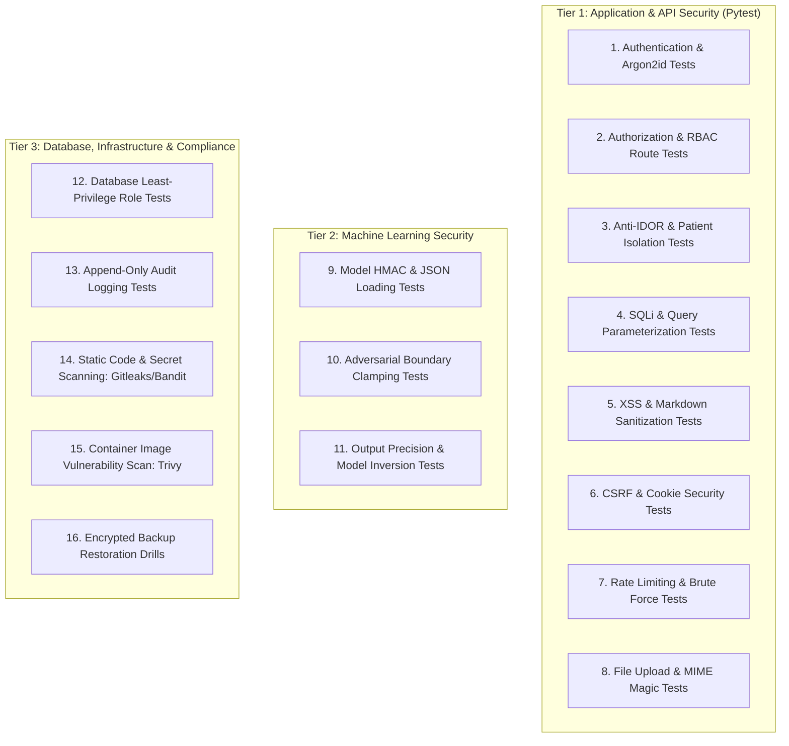

# SECURITY TESTING AND ACCEPTANCE SPECIFICATION

**Document Reference:** `docs/security/SECURITY_TESTING_AND_ACCEPTANCE.md`  
**Phase:** 09 — Security, Privacy, Data Protection & Threat Modelling  
**Status:** Approved Technical Test Plan  
**Author:** Security QA Lead & Application Penetration Tester  
**Traceability:** NFR-SEC-01 through NFR-SEC-09, ADR-009, ADR-011  

---

## 1. Executive Summary & Verification Rule

In healthcare software development, security claims without executed, repeatable test proof are invalid. 

> [!WARNING]
> **Strict Verification Rule:**  
> Security tests must never be reported as "passed" merely because a plan was authored. Tests are formally recorded as "passed" **only after actual automated execution against running code**, with verifiable test logs and pass/fail assertion output committed to the project audit record.

This specification defines the 16-tier security test suite, automated Pytest integration, measurable acceptance thresholds, and severity-based release blockers for HeartXAI 2.0.

---

## 2. Comprehensive Security Test Suite (16 Tiers)

---

## 3. Automated Test Scenarios & Detailed Assertions

### Test Tier 1: Authentication & Password Security (`tests/security/test_auth_security.py`)
- **SEC-TEST-01 (Argon2id Verification):** Assert that password hash strings start with `$argon2id$v=19$m=65536,t=3,p=4$`.
- **SEC-TEST-02 (Account Enumeration Defense):** Execute 100 requests to `/api/v1/auth/login` with valid usernames (wrong password) and 100 requests with invalid usernames. Assert that response payloads are identical and execution time distribution delta is $\le 50\text{ ms}$.
- **SEC-TEST-03 (Token Invalidation on Password Change):** Authenticate, capture access token, change password via `POST /api/v1/users/me/change-password`, then verify that the prior access and refresh tokens immediately return `HTTP 401 Unauthorized`.

### Test Tier 2: Anti-IDOR & Patient Data Isolation (`tests/security/test_idor_isolation.py`)
- **SEC-TEST-04 (Horizontal Privilege Isolation):** 
  1. Create Patient A (`id=101`) and Patient B (`id=102`).
  2. Patient A submits a prediction, generating `prediction_id=501`.
  3. Authenticate as Patient B and send `GET /api/v1/predictions/501`.
  4. **Assertion:** Response must be `HTTP 404 Not Found` (or 403), with zero prediction data leaked.
- **SEC-TEST-05 (Admin Segregation):** Authenticate as an `ADMIN` role user. Send `GET /api/v1/predictions/501`.
  - **Assertion:** Response must be `HTTP 403 Forbidden`, proving administrators cannot browse individual patient clinical records.

### Test Tier 3: Injection & Input Validation (`tests/security/test_input_injection.py`)
- **SEC-TEST-06 (SQL Injection Fuzzing):** Inject 50 standard SQL injection payloads (`' OR 1=1 --`, `1; DROP TABLE users;`) into search query parameters.
  - **Assertion:** 100% of responses return clean HTTP 200 (escaped search) or HTTP 422; zero SQL errors or schema leakage.
- **SEC-TEST-07 (Adversarial Physiological Range Clamping):** Send `POST /api/v1/predictions` with blood pressure $= 350\text{ mmHg}$ and age $= -5$.
  - **Assertion:** Returns `HTTP 422 Unprocessable Entity` with explicit Pydantic range validation errors.

### Test Tier 4: File Upload & Antivirus Sandbox (`tests/security/test_file_security.py`)
- **SEC-TEST-08 (MIME Masquerading Rejection):** Create an executable shell script renamed to `report.pdf`. Attempt upload to `/api/v1/files/upload`.
  - **Assertion:** Magic-byte inspection rejects payload with `HTTP 415 Unsupported Media Type`.
- **SEC-TEST-09 (Oversized File Rejection):** Attempt upload of a $10\text{ MB}$ payload.
  - **Assertion:** Request rejected with `HTTP 413 Payload Too Large`.

### Test Tier 5: ML Subsystem Security (`tests/security/test_ml_security.py`)
- **SEC-TEST-10 (Model Tampering Rejection):** Modify a single byte in `cleveland_xgboost.json`. Attempt to start or reload the ML engine.
  - **Assertion:** Engine raises `ModelIntegrityException` and aborts; tampered model is never loaded.
- **SEC-TEST-11 (Immutable Counterfactual Clamps):** Execute counterfactual optimization on high-risk patient.
  - **Assertion:** Output delta for age and sex must be exactly zero ($\Delta x_{\text{age}} = 0, \Delta x_{\text{sex}} = 0$).

---

## 4. Measurable Acceptance Criteria & Release Blockers

A software release candidate is approved for production deployment **only** if it satisfies 100% of the following criteria:

| Acceptance Criterion | Metric / Measurement Threshold | Enforcement Mechanism | Failure Severity |
| :--- | :--- | :--- | :---: |
| **Automated Test Suite Pass Rate** | $100\%$ pass rate across all 16 security test tiers | Pytest CI runner | **CRITICAL (Blocker)** |
| **Critical / High CVEs in Dependencies** | **ZERO** unresolved Critical or High CVEs | `pip-audit` & `npm audit` | **CRITICAL (Blocker)** |
| **Container Image CVEs** | **ZERO** Critical CVEs, $\le 2$ High with approved waivers | Trivy Container Scan | **CRITICAL (Blocker)** |
| **Secret Scanning Violations** | **ZERO** credentials or keys detected | Gitleaks CI Check | **CRITICAL (Blocker)** |
| **SAST Security Flaws** | **ZERO** high-confidence Bandit/Semgrep findings | Bandit / Semgrep CI Check | **HIGH (Blocker)** |
| **IDOR Vulnerabilities** | **ZERO** horizontal or vertical privilege escalations | Automated IDOR Pytests | **CRITICAL (Blocker)** |
| **Backup Restoration** | Successful automated restore drill within 30 days | Sandbox Restore Script | **HIGH (Blocker)** |

---

## 5. Security Test Execution Protocol

In future implementation phases:
1. All security test cases reside under `backend/tests/security/`.
2. Tests execute against an isolated test PostgreSQL and Redis container instance.
3. Execution reports, including coverage matrices and timestamped logs, must be published to `docs/security/reports/` prior to Phase sign-off.
