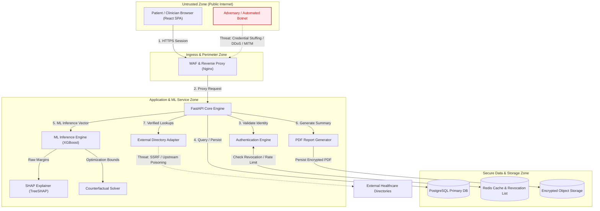

# THREAT MODEL AND THREAT REGISTER (STRIDE METHODOLOGY)

**Document Reference:** `docs/security/THREAT_MODEL_AND_THREAT_REGISTER.md`  
**Phase:** 09 — Security, Privacy, Data Protection & Threat Modelling  
**Status:** Approved Technical Threat Model  
**Author:** Principal Application Security Architect & Threat Intelligence Specialist  
**Traceability:** NFR-SEC-01 through NFR-SEC-09, ADR-009, ADR-011  

---

## 1. Executive Summary & Methodology

This document performs a comprehensive STRIDE threat modeling assessment of HeartXAI 2.0. STRIDE categorizes adversarial vectors across six domains:
- **S**poofing identity
- **T**ampering with data
- **R**epudiation
- **I**nformation disclosure (privacy breach)
- **D**enial of service
- **E**levation of privilege

Threats are analyzed across all 11 architectural components:
1. Patient Web Application (React 18 SPA)
2. Authentication System (Argon2id + JWT / Refresh Cookies)
3. FastAPI Backend Core Engine
4. PostgreSQL Database Tier
5. ML Inference Engine (XGBoost Runtime)
6. SHAP Explanation Service (TreeSHAP)
7. Counterfactual Generation Engine
8. File Uploads & Generated Medical Reports
9. External APIs & Country Directory Adapters
10. Administrative Interface & Operations
11. Deployment Infrastructure & Container Runtime

---

## 2. STRIDE Architectural Threat Model Diagram

---

## 3. Comprehensive STRIDE Threat Register

The following register details the top threats identified across the 11 components:

### Threat 01: Insecure Direct Object Reference (IDOR) on Patient Prediction History
- **Threat ID:** `THR-AUTHZ-001`
- **STRIDE Category:** Elevation of Privilege / Information Disclosure
- **Affected Component:** FastAPI Backend Core Engine (`/api/v1/predictions/{id}`)
- **Attack Scenario:** An authenticated patient with `user_id = 101` changes the prediction identifier in a GET request to `/api/v1/predictions/102`, attempting to read another patient's clinical biomarkers, calculated risk scores, and SHAP feature attributions.
- **Potential Impact:** Massive breach of patient privacy, violation of healthcare privacy laws, loss of organizational trust.
- **Severity:** **Critical (12)**
- **Preventive Controls:** Backend route dependency (`deps.py`) enforces strict resource ownership: `WHERE prediction.id = :id AND prediction.user_id = :current_user.id`. Requests for non-owned records return `HTTP 404 Not Found` (to prevent ID enumeration).
- **Detection Controls:** Audit log trigger detects consecutive 404/403 errors across incrementing integer IDs, flagging potential IDOR scanning activity.
- **Recovery / Response:** Automated IP temporary rate limit clamp; alert sent to security operations; account flagged for review.
- **Residual Risk:** Low (mitigated by automated unit tests and query-level assertions).

---

### Threat 02: Credential Stuffing & Distributed Brute-Force Attacks
- **Threat ID:** `THR-AUTH-002`
- **STRIDE Category:** Spoofing Identity
- **Affected Component:** Authentication System (`/api/v1/auth/login`)
- **Attack Scenario:** An attacker leverages a leaked database of usernames and passwords from an unrelated breach to execute automated credential stuffing across `/api/v1/auth/login` using distributed residential proxies.
- **Potential Impact:** Unauthorized account takeover, unauthorized access to personal health records.
- **Severity:** **High (9)**
- **Preventive Controls:**
  1. Redis sliding-window rate limiting (maximum 5 failed login attempts per username and per IP per 15 minutes).
  2. Integration of CAPTCHA / bot challenge triggered upon 3 consecutive failures.
  3. Argon2id password hashing prevents rapid local offline verification if database hashes are leaked.
- **Detection Controls:** Real-time SIEM alert triggered when the platform-wide failed-to-successful login ratio exceeds $30\%$.
- **Recovery / Response:** Temporary IP block; automated password reset email sent to targeted user; forced invalidation of active refresh tokens.
- **Residual Risk:** Low.

---

### Threat 03: Malicious File Upload Executing Arbitrary Code on Server
- **Threat ID:** `THR-FILE-003`
- **STRIDE Category:** Tampering / Elevation of Privilege
- **Affected Component:** File Uploads & Generated Medical Reports (`/api/v1/files/upload`)
- **Attack Scenario:** An attacker uploads a PHP, Python, or shell script masquerading as an ECG PDF (`payload.pdf.php` or a file with valid PDF magic bytes followed by malicious executable script), attempting Remote Code Execution (RCE) on the backend server.
- **Potential Impact:** Full host compromise, root-level shell access, extraction of database connection secrets.
- **Severity:** **Critical (12)**
- **Preventive Controls:**
  1. Multi-tier validation: File extension whitelisting (`.pdf`, `.png`, `.jpg` only), magic-byte MIME type inspection via `python-magic`.
  2. Storage isolation: Files are immediately streamed to an isolated, non-executable private object store bucket with random UUID names (`f47ac10b-58cc-4372-a567-0e02b2c3d479`). No user-supplied filename is ever retained on disk.
  3. Antivirus scanning: Asynchronous ClamAV scan container inspects file stream before persistent commitment.
- **Detection Controls:** ClamAV virus signature alert; file type mismatch warning logged.
- **Recovery / Response:** Immediate deletion of tainted object; IP address ban; security incident ticket generated.
- **Residual Risk:** Low.

---

### Threat 04: Adversarial Input Perturbation Exploiting ML Decision Boundaries
- **Threat ID:** `THR-ML-004`
- **STRIDE Category:** Tampering
- **Affected Component:** ML Inference Engine & Bounded Counterfactual Solver
- **Attack Scenario:** An attacker submits extreme out-of-distribution values (e.g., blood pressure $= 450\text{ mmHg}$, negative age, or non-physiological NaN values) to trigger floating-point exceptions, crash worker threads, or manipulate counterfactual solvers into suggesting absurd non-medical guidance.
- **Potential Impact:** Denial of Service in worker thread pool; loss of clinical credibility; potentially hazardous guidance displayed to user.
- **Severity:** **High (9)**
- **Preventive Controls:**
  1. Pydantic V2 input validation strictly enforces physiological ceilings and floors ($80 \le \text{trestbps} \le 240\text{ mmHg}$).
  2. The counterfactual optimizer enforces hard mathematical box constraints preventing continuous variables from leaving clinical safety intervals.
- **Detection Controls:** `FeatureOutOfBoundException` logging; input distribution anomaly alerts in Datadog/CloudWatch.
- **Recovery / Response:** Request rejected with HTTP 422 Unprocessable Entity; client receives structured validation error.
- **Residual Risk:** Low.

---

### Threat 05: Model Artifact Tampering / Malicious Deserialization
- **Threat ID:** `THR-ML-005`
- **STRIDE Category:** Tampering / Elevation of Privilege
- **Affected Component:** ML Model Artifact Storage & Loading Pipeline
- **Attack Scenario:** An adversary gains write access to the filesystem or CI/CD deployment bucket and replaces `cleveland_xgboost.json` or `cleveland_scaler.joblib` with a malicious payload executing arbitrary shell commands upon loading.
- **Potential Impact:** Full application server compromise, silent alteration of clinical diagnostic predictions.
- **Severity:** **Critical (12)**
- **Preventive Controls:**
  1. Native JSON serialization for all tree models, eliminating executable Python pickle bytecodes.
  2. HMAC-SHA256 signature verification: At application startup, the engine computes the SHA-256 hash and HMAC signature of all artifacts using an offline secret key. Mismatched artifacts immediately abort startup with `ModelIntegrityException`.
- **Detection Controls:** Startup self-check audit failure logged to security operations.
- **Recovery / Response:** Backend container enters crash-loop state, preventing traffic routing; operational alert triggered.
- **Residual Risk:** Very Low.

---

### Threat 06: Server-Side Request Forgery (SSRF) via Country Directory Adapters
- **Threat ID:** `THR-INT-006`
- **STRIDE Category:** Tampering / Information Disclosure
- **Affected Component:** External APIs & Country Directory Adapters (`app/services/directory_service.py`)
- **Attack Scenario:** An attacker manipulates country configuration or directory search parameters to force the backend server to make HTTP requests to internal cloud metadata endpoints (`http://169.254.169.254/latest/meta-data/`) or internal databases (`http://10.0.0.5:5432`).
- **Potential Impact:** Cloud IAM instance profile credential theft, internal network reconnaissance.
- **Severity:** **Critical (12)**
- **Preventive Controls:**
  1. Strict outgoing URL whitelist: Adapters are hardcoded to specific, verified public API hostnames.
  2. DNS resolution check: Custom HTTP client transport verifies that resolved IP addresses do not fall within RFC 1918 private subnets (`10.0.0.0/8`, `172.16.0.0/12`, `192.168.0.0/16`) or link-local ranges (`169.254.0.0/16`).
- **Detection Controls:** Outbound firewall egress monitor alerts on connection attempts to private IP ranges.
- **Recovery / Response:** Connection immediately terminated; internal security incident logged.
- **Residual Risk:** Low.

---

### Threat 07: Cross-Site Scripting (XSS) Leading to Session Hijacking
- **Threat ID:** `THR-WEB-007`
- **STRIDE Category:** Information Disclosure / Elevation of Privilege
- **Affected Component:** Patient Web Application (React SPA)
- **Attack Scenario:** An attacker injects malicious JavaScript via a medical report title or doctor notes field. If rendered unescaped in another user's browser, the script attempts to read authentication tokens from `localStorage` or `sessionStorage`.
- **Potential Impact:** Complete account takeover of viewing patients or clinicians.
- **Severity:** **High (9)**
- **Preventive Controls:**
  1. Architecture rejects token storage in `localStorage`. Access tokens reside in memory; refresh tokens reside in `HttpOnly`, `Secure`, `SameSite=Strict` cookies inaccessible to JavaScript.
  2. Contextual HTML escaping in React by default; all user markdown sanitized via DOMPurify.
  3. Content Security Policy (CSP Level 3) with `script-src 'self'` and `object-src 'none'` blocks inline script execution.
- **Detection Controls:** CSP violation report-uri endpoint logs unauthorized script injection attempts.
- **Recovery / Response:** Invalidation of reported user session; CSP policy review.
- **Residual Risk:** Low.

---

### Threat 08: SQL Injection via Dynamic Query Construction
- **Threat ID:** `THR-DB-008`
- **STRIDE Category:** Tampering / Information Disclosure
- **Affected Component:** PostgreSQL Database Tier
- **Attack Scenario:** An adversary injects SQL fragments (`' OR '1'='1`) into directory search or filtering endpoints to dump the entire `users` or `predictions` table.
- **Potential Impact:** Catastrophic data breach of all patient records and credentials.
- **Severity:** **Critical (12)**
- **Preventive Controls:**
  1. 100% of database queries utilize SQLAlchemy 2.0 ORM expressions or explicitly parameterized queries (`text("SELECT ... WHERE col = :val")`). Raw string concatenation or f-strings in queries are strictly forbidden.
  2. Database user `heartxai_app` is restricted from executing administrative DDL or accessing system catalogs.
- **Detection Controls:** Automated SAST scanning (Bandit, Semgrep) in CI/CD pipeline detects any dynamic SQL formatting.
- **Recovery / Response:** Immediate deployment rollback if a vulnerable query pattern is detected.
- **Residual Risk:** Very Low.

---

### Threat 09: Repudiation of Clinical Report Alteration or Consent Revocation
- **Threat ID:** `THR-REP-009`
- **STRIDE Category:** Repudiation
- **Affected Component:** Administrative & Audit Logging Subsystem
- **Attack Scenario:** A malicious user or rogue administrator alters a patient's prediction record or claims they revoked consent prior to a clinical data export, with no auditable trace of the modification.
- **Potential Impact:** Medico-legal liability, regulatory penalties, inability to defend clinical decision support integrity.
- **Severity:** **High (8)**
- **Preventive Controls:**
  1. PostgreSQL append-only audit logging: Database triggers capture `OLD` and `NEW` row states for all mutations in `predictions` and `user_consents`.
  2. Permissions: The application connection user has zero `DELETE` or `UPDATE` privileges on `audit_logs`.
- **Detection Controls:** Cryptographic chaining (hash-chain verification) of audit records detects any manual row modification or truncation.
- **Recovery / Response:** Cryptographic audit trail establishes verified timeline for legal discovery.
- **Residual Risk:** Low.

---

### Threat 10: Model Inversion / Membership Inference Attack
- **Threat ID:** `THR-ML-010`
- **STRIDE Category:** Information Disclosure
- **Affected Component:** SHAP Explanation Service & Model Output Router
- **Attack Scenario:** An adversary queries `/api/v1/predictions` repeatedly with high-precision inputs and inspects unrounded floating-point output probabilities and SHAP margins to infer whether a specific target individual was included in the original training cohort.
- **Potential Impact:** Leakage of patient participation in historical clinical trial cohorts.
- **Severity:** **Medium (6)**
- **Preventive Controls:**
  1. Output probabilities and SHAP attributions rounded to 4 decimal places, adding numerical quantization noise that breaks gradient-based reconstruction.
  2. Rate limiting (max 10 prediction requests/min per authenticated user).
  3. The Cleveland training dataset is an open-source public benchmark, limiting proprietary training cohort exposure.
- **Detection Controls:** Anomaly detection on rapid, programmatic prediction queries.
- **Recovery / Response:** Automated rate clamp; user query pattern flagged for investigation.
- **Residual Risk:** Low.
